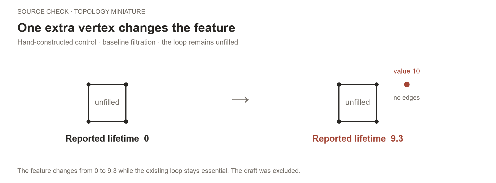

# Benchtop

**Small research labs that agents investigate through budgeted MCP tools.**

An agent chooses experiments, reads measurements, and commits to an answer. A separate grader checks it on held-out seeds. Submission returns only a receipt.

[85-second Qualia demo](demo/benchtop-qualia.mp4) · [Full results](release-results/report.md) · [Code and controls](examples/topology/README.md)

## One concrete finding

A generated topology lab passed execution checks. Adding an isolated vertex changed its reported loop lifetime from **0 to 9.3** without filling the loop. Nine controls expose the feature convention. The draft was excluded before qualification; no source-paper defect or classification effect is claimed.



## What the study found

| Evidence | Outcome |
| :--- | :--- |
| 48 development sessions | 40 correct; the fixed rule selected a 6% budget. |
| 16 fresh papers | One qualified lab; all 12 pilot answers correct. |
| Independent grading | Ambiguous at the fixed margin; no usable confirmation comparison. |
| 14,400 historical policy replays | No consistent benefit from the added cost heuristic. |

**No calibration benefit or RL-training improvement is demonstrated.** The inconclusive result, exclusions, and unknown costs remain in the package.

## What is implemented

- Three MCP tools, separate agent/admin endpoints, and per-episode capabilities.
- Sandboxed CPU execution, cached replay, and immutable attempt accounting.
- A real Qualia conversation. The edited recording discloses its missing opening segment and unavailable exact provider model ID; it establishes connectivity, not a study reward.
- [Two cached server exercises](reliability/README.md), each with 8,000 requests and 1,000 simulated clients. No unexpected errors; burst latency and client queuing are reported.

The source checks were prepared by Codex and approved by me. They are not independent human reviews. [Scope and assessment procedure](review/README.md).

## Reproduce

```sh
uv sync --locked
uv run python reproduce.py
```

Uses cached evidence. Starts no model or lab worker.
