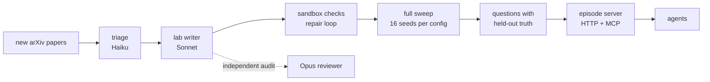
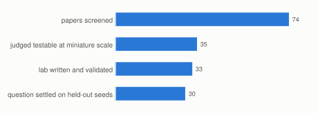
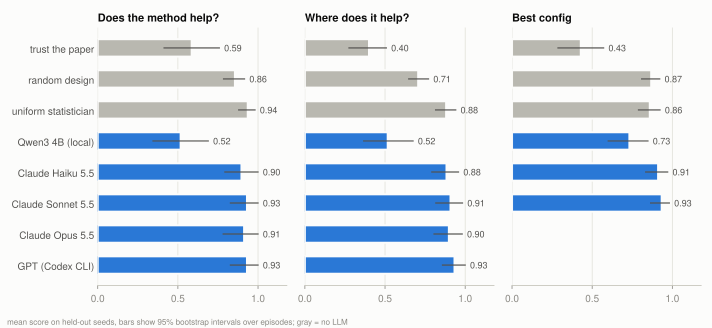
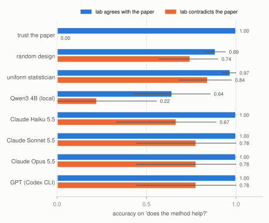
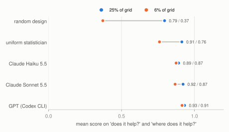
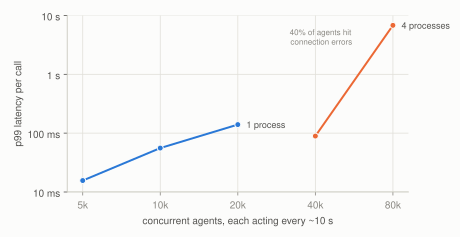

# benchtop

benchtop turns new arXiv papers into small runnable labs that work as RL environments for research taste. An agent gets a question about a paper's claim, spends a compute budget on experiments, and is graded on seeds it never saw.



## Why

Training a model on research judgment needs environments that are cheap to run, have a verifiable reward, and keep coming. Hand-built evals like TasteVal ([2610.06824](https://arxiv.org/abs/2610.06824)) spend about 40 H100-hours per run on 8 hidden tasks. That's fine for measurement, but too slow and too few for RL.

benchtop goes the other way. Each lab is a miniature of one paper's central comparison that runs in milliseconds on a laptop CPU. The whole grid is swept ahead of time, so every episode step is a lookup and every grade is exact.

## One day of arXiv



- 74 cs.LG and stat.ML papers from Oct 27, 2026, months after the Claude models' training cutoff, so nothing to memorize
- 30 became labs, 26 of them on the lab writer's first try. Median build time was about 100 s, and the total cost was about $7 at API prices ($0.24 per lab, $0 on a subscription)
- the most common reason a paper didn't make it: it needs a pretrained LLM (27 papers)
- an independent Opus audit passed 25 labs. 2 had unfair baselines and 3 were low fidelity. One more is outlier-dominated (one setting drives the whole average), which leaves a clean set of 24

## What a lab is

Two files. `lab.py` has `run(config, seed) -> metrics`. `space.json` lists the factors: the paper's method vs a baseline, plus 2 or 3 settings where the effect might change.

Example, [2610.36983](https://arxiv.org/abs/2610.36983) "Advancement or Acceleration? How Data Curation Improves LLM Training":

| | |
|---|---|
| paper's claim | curation helps only when there is a correctable train/target gap |
| method | `uniform` vs `target_select` |
| settings | `gap_deg` 0 / 30 / 60, `n_pool` 200 / 2000, `label_noise` 0 / 0.2 |
| one run | 2 ms on one core |
| held-out truth | no effect on average; hurts at gap 0, helps at gap 60; helps on clean labels, hurts with noisy ones |

## Episodes

- three question types: *does it help?* (averaged over settings), *where does it help?* (per level of one setting), and *best config*
- 16 seeds per config: 4 visible to the agent, 12 held out for grading
- both arms share seeds (same data split, same init), so paired comparisons work
- a question only exists if the held-out seeds settle it at 95% confidence
- the budget is a quarter of the visible grid (6% in the tight runs), charged at each config's real runtime
- agents get three tools and nothing else: `describe_lab`, `run_experiments`, `submit_answer`
- labs run under macOS `sandbox-exec` with no network, no writes outside a temp dir, and no reads of results or docs

## Agents



Agents get identical episodes and seeds with a budget of 25% of the visible grid. Haiku, Sonnet and Qwen played all 78 episodes, GPT the 49 claim and where episodes, and Opus the 41 on audit-clean labs. Claude runs through `claude -p` with only the three lab tools. GPT runs through the Codex CLI with its shell turned off. Qwen3 4B runs locally through Ollama.

- at this budget, frontier agents tie a uniform-design baseline that uses no LLM (0.93 vs 0.94 on *does it help?*)
- Qwen3 4B scores at the level of blindly trusting the paper, at 0.96 mean confidence
- the Claude models are slightly underconfident (0.82 to 0.85 confidence at 0.90 to 0.93 accuracy). GPT is close to calibrated (Brier 0.03)
- Sonnet stops early and uses 64% of its budget on average. Opus uses 85%, GPT 97%

### When the lab disagrees with its paper



On the 24 clean labs, 14 agree with their paper and 9 contradict it. Every frontier agent is perfect on the first group and drops to 0.67 to 0.78 on the second. Some of that drop is just difficulty: the uniform design also falls, from 0.97 to 0.84, because contradicting labs tend to have small or null effects.

The agents mostly aren't fooled by the abstract. Hiding the paper's claim barely moved Haiku on contradicting labs (0.85 to 0.90 over 48 paired episodes, 95% CI -0.04 to +0.13). Sonnet and Opus never overrode their own data in the paper's favor. Each missed 6 of 41 clean questions. In 3 (Sonnet) and 4 (Opus) of those, the experiments they chose really did point to the wrong answer, which fits the early stopping above.

### Tight budgets



At 25% of the grid, brute force works. At 6% (about 8 runs), choosing which experiments to run starts to matter. Every frontier agent beats the uniform design on the same episodes:

| | *does it help?* | vs uniform (95% CI) | *where does it help?* | vs uniform (95% CI) |
|---|---|---|---|---|
| uniform design | 0.83 | | 0.66 | |
| Claude Haiku 5.5 | 0.90 | +0.07 (-0.02 to +0.15) | 0.84 | +0.18 (+0.09 to +0.27) |
| Claude Sonnet 5.5 | 0.93 | +0.10 (+0.02 to +0.18) | 0.78 | +0.11 (+0.02 to +0.20) |
| GPT (Codex CLI) | 0.97 | +0.14 (+0.04 to +0.23) | 0.84 | +0.18 (+0.08 to +0.28) |

Going from 25% to 6% of the grid, the agents lose 2 to 5 points, the uniform design 15, and random design 42. That gap is the part of research taste these labs can measure: knowing which runs settle the question.

### Rollout groups

Six groups of eight Haiku rollouts, each group on one episode seed (like a GRPO group), asked for 1,393 experiment runs in total, but only 312 were unique. A shared cache skips 78% of the work (63% at the 6% budget). Even together, a group touches only 38% of the visible grid. In live mode (run on demand, coalesce identical requests, cache), that's all the agent-facing compute a group needs. Only the held-out grading seeds still have to be swept.

At the 25% budget, 5 of 6 groups were all correct: no reward variance, so no GRPO signal. At 6%, on the same six episodes, 2 groups split and 4 were still all correct. So the tight budget separates agents from baselines, but on its own it doesn't give GRPO much to learn from. A training set would also need episodes the policy sometimes fails.

## Scale



Episodes are tiny state machines over a swept table, so the cost of an environment step is a dict lookup.

- in-process (for an RL loop): 110k episode creations/s and 53k steps/s on one core, about 0.7 KB per open episode
- over HTTP, one uvicorn process does about 8,200 requests/s closed-loop (p99 3.6 ms)
- with LLM-paced agents (each acting about every 10 s), one process holds 5,000 concurrent episodes at p99 16 ms with no errors, and 20,000 at p99 140 ms
- episodes are independent, so they shard by id. Four processes hold 40,000 at p99 89 ms

The load generator ran on the same 11-core laptop as the servers. The servers logged no errors. The 0.2 to 3% of agents that hit connection resets were caused by macOS limits (a 128-connection accept queue, 16k ephemeral ports). At 80,000 agents those limits take over and 40% of agents fail.

## Use it

```sh
uv sync
uv run benchtop fetch --n 200 --name today       # recent cs.LG + stat.ML
uv run benchtop triage --listing today           # can it be miniaturized?
uv run benchtop build --listing today --jobs 3   # write, check, sweep, keep or drop
uv run benchtop serve                            # http://127.0.0.1:8787
uv run benchtop rollouts --agent claude:sonnet   # or claude:haiku, ollama:qwen3:4b-instruct, codex:default
uv run benchtop report
```

Any MCP client can play an episode. `uv run benchtop episode <env> <task>` prints a URL like `http://127.0.0.1:8787/e/<id>/mcp`. The MCP SDK only accepts localhost Host and Origin headers by default, so for a client that connects through a tunnel or sends its own Origin, start the server with `--any-host`.

In-process, for an RL loop:

```python
from benchtop.gym import make

lab = make("2610-36983-advancement-or-acceleration-how", "where:gap_deg")
obs, info = lab.reset(seed=0)
obs, reward, done, info = lab.step({"tool": "run_experiments", "configs": [{"method": "target_select"}], "seeds": 2})
```

## Limits

- the lab is the world. A lab can disagree with its paper because the claim doesn't hold at small scale, or because the lab writer got something wrong. The audit catches some of the second kind, not all
- settings are discrete grids, so "propose a new method" isn't covered, only choosing and reading experiments
- miniatures run on CPU in milliseconds, so anything that truly needs scale (LLM pretraining, large vision models) gets triaged out
- one day of papers and one rollout per agent per episode for most numbers, so the intervals are wide
- the sandbox is macOS only for now; Linux would want a container or gVisor backend behind the same worker protocol
