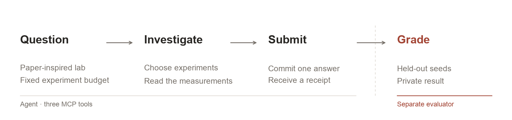
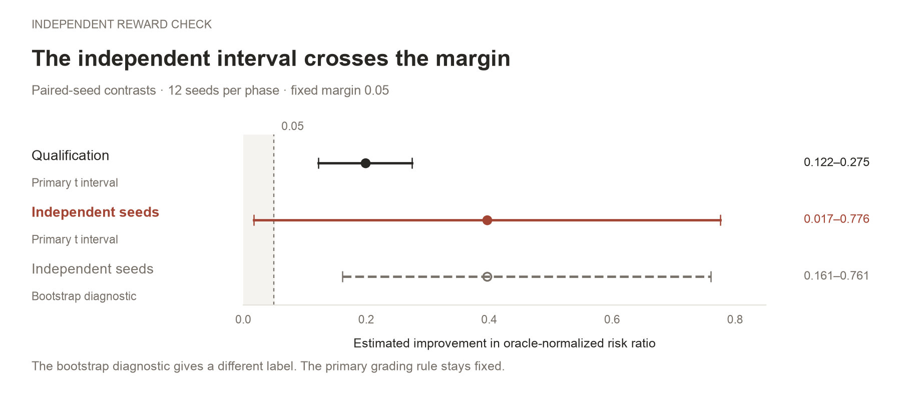
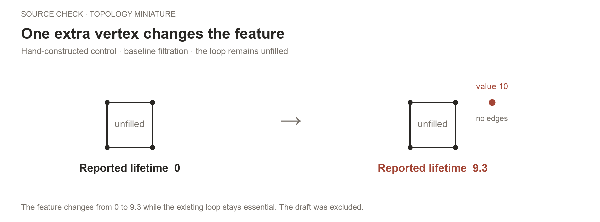
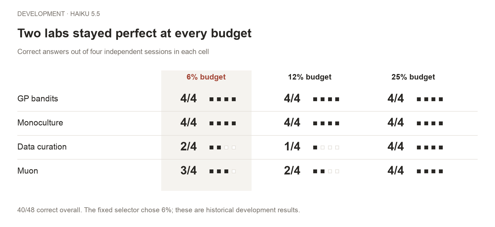
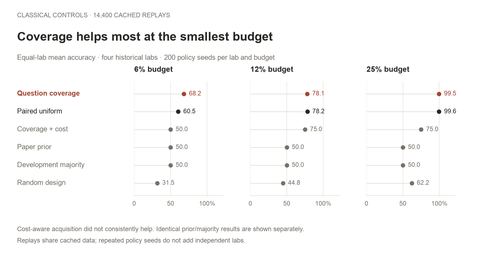

# benchtop

Small paper-inspired labs where agents choose experiments on a budget, then answer a research question. Grading uses seeds the agent never saw.



[Watch it run in Qualia](demo/benchtop-qualia.mp4) · [Short brief](PROJECT_BRIEF.md) · [Full results](release-results/report.md)

## Features

- **Budgeted experiments** through three MCP tools, with a working Qualia demo.
- **Shared experiment caches** so repeated agent sessions can reuse the same CPU runs.
- **Private grading** with separate agent/admin endpoints and checks before a generated lab enters evaluation.

## Reproduce

```sh
uv sync --locked
uv run python reproduce.py
```

Tested on macOS with Python 3.12. This verifies the package and recomputes the cached analysis without starting a model or running lab code.

## Results

The development run finished **40/48 correct**. Of 16 fresh papers, one produced a qualified lab. Its independent grading was ambiguous, so the study closed without a usable confirmation comparison or a demonstrated calibration benefit.



One generated lab also passed execution checks but failed source review: an unrelated vertex changed its loop-lifetime feature from **0 to 9.3** without filling the loop. That draft stayed out of the study.

<details>
<summary>Example: the lab that failed source review</summary>



The control exposes a convention in the generated features. It does not show an error in the source paper or measure an effect on classification accuracy. The draft was excluded before qualification.

[Code and nine runnable controls](examples/topology/README.md)

</details>

<details>
<summary>Study design and complete outcomes</summary>

The calibration rule tries to find budgets that produce groups containing both correct and incorrect answers. Development selected one global budget; fresh pilots tested a budget choice for each qualified lab.

| Stage | Recorded outcome |
| :--- | :--- |
| Development | 48 Haiku sessions on four historical labs; 40 correct. The fixed rule selected a 6% budget. |
| Fresh candidates | 16 papers, nine substantive source assessments, one qualified lab. Two other scoped miniatures had inconclusive qualification labels. |
| Pilots | All 12 answers correct. No budget produced an observed mixed reward group. |
| Independent check | The primary interval crossed the fixed 0.05 effect margin. The more favorable bootstrap diagnostic gave a different label; the primary rule stayed fixed. |
| Confirmation | All 16 planned slots retained as unavailable; no confirmation model starts. No primary calibration estimate or uncertainty interval. |

[Full report](release-results/report.md) · [Source assessments](review/README.md)

</details>

<details>
<summary>Development sessions and classical controls</summary>

Four Haiku sessions per lab and budget. GP bandits and monoculture were correct at every budget, so neither produced an observed mixed reward group.



The 14,400 cached policy replays cover four labs, six policies, three budgets, and 200 policy seeds. Question coverage helped at the smallest budget. Adding the cost heuristic did not consistently help. Repeated policy seeds reuse the same experiment tables; they do not add independent labs.



[Development data and figure source](development/README.md)

</details>

<details>
<summary>MCP tools and execution</summary>

| Tool | What the agent can do |
| :--- | :--- |
| `describe_lab` | Read the question, factors, and experiment budget. |
| `run_experiments` | Choose configurations and inspect the returned measurements. |
| `submit_answer` | Commit an answer and confidence; receive a receipt. |

Paired experiment tables are collected once on CPU, then shared across cached episodes. Each agent still spends its own logical budget. Hidden results and grades stay outside the agent interface.

[Agent/admin separation](benchmarks/release_v1/ACCESS.md) · [Sandboxed workers and versioned caches](benchmarks/release_v1/CACHE.md)

</details>

<details>
<summary>Demo, reliability, and review limits</summary>

**Qualia demo.** One actual desktop conversation used the three MCP tools. The 85-second edit shows real footage. Its opening segment was lost during a recorder restart; the saved tool log verifies that call. The exact provider model ID was unavailable, so this establishes historical connectivity rather than a study reward. [Recording notes](demo/README.md).

**Reliability.** Two local cached server exercises each completed 8,000 requests across 1,000 simulated clients, with zero unexpected errors. Burst latency was high; client queuing and timing limits remain in the [report](reliability/README.md).

**Scope.** These are miniature experiments, not paper replications. No RL training was performed. Claude generated the lab drafts; Codex helped with implementation and source checks. I approved the decisions. Those checks are not independent human reviews. [Assessment procedure and exclusions](review/README.md).

</details>
