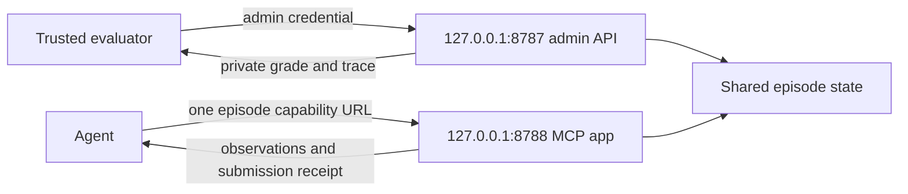

# Agent and evaluator access

Benchtop serves two separate ASGI apps on loopback sockets in one process and event loop. Administrative routes are not mounted in the agent app. Routing uses the socket's local port, not an HTTP Host or forwarded header.



## Start and create an episode

```sh
uv run benchtop serve
uv run benchtop episode 2610-36983-advancement-or-acceleration-how where:gap_deg
```

`serve` keeps the admin API on port 8787 and uses 8788 for MCP. `--port` changes the admin port; the default agent port is the next number. `--agent-port` selects a different agent port. Both listeners bind to 127.0.0.1.

The episode command uses the trusted local client and prints the agent URL. Its form is `http://127.0.0.1:8788/e/EPISODE_ID/CAPABILITY/mcp`. The capability contains 32 random bytes encoded for URLs and authorizes only that episode. Copy the actual printed URL into the intended MCP client. The ID alone is not authorization.

An agent can list and call only `describe_lab`, `run_experiments`, and `submit_answer`. Incoming episode headers are stripped and replaced with the identity authorized by the URL. The agent endpoint does not provide creation, reset, enumeration, health, or grading routes. Completion returns a receipt without reward or truth. Eviction and server restarts invalidate the old capability; repeated submissions on a retained episode remain receipts.

Claude and Codex receive the capability URL from episode creation rather than constructing a URL from the admin address. The Ollama harness proxies model tool calls through the same scoped MCP interface. Private grading is read separately by the evaluator after the episode.

## Read a grade as the operator

The server generates a separate admin credential and writes a mode-0600 profile under ignored `.state/servers/ADMIN_PORT.json`. The trusted `Client` reads the profile matching its exact loopback origin. No admin credential is placed in the model prompt or MCP configuration.

```sh
uv run python - <<'PY'
from benchtop.agents.common import Client

client = Client()
print(client.summary("REPLACE_WITH_EPISODE_ID")["result"])
client.http.close()
PY
```

All administrative HTTP routes require the admin credential. An episode capability cannot authenticate to them. Administrative requests with an Origin header or a non-loopback Host are rejected. Direct unauthenticated curl requests no longer read grades. Graceful shutdown removes the matching credential profile; starting a server rotates its credentials.

The authenticated `/episodes/ID/mcp-trace` route exposes bounded MCP activity for [operator-assisted integration capture](QUALIA.md). It is absent from the agent app. Events record tool names and response metadata, without credentials or tool arguments. They are separate from immutable final episode results and repeated-submission receipts.

## External MCP clients

Host and Origin checks remain enabled. `--any-host` has been removed. An explicit `--agent-base` advertises the external agent origin and allows its Host header. Additional exact hosts or origins can be supplied with repeated `--allowed-host` and `--allowed-origin` flags; custom wildcards are rejected.

For a later tunnel-based integration, point the tunnel at **8788**, the agent listener. Keep the admin listener local. After obtaining a tunnel origin, start the server with that exact origin:

```sh
uv run benchtop serve --agent-base https://REPLACE_WITH_TUNNEL_HOST
```

If the client sends an Origin header, allow its actual value explicitly. `--allowed-origin app://qualia` is a tested header configuration, not evidence that the current Qualia client sends it. Create a new episode after restarting and use its new printed URL.

Capability URLs are credentials. Keep raw configurations and transcripts private. Structured rollout records redact capability URLs and credential fields, and server access logging is disabled. For a public video, omit the raw URL or stop the server before publishing it.

## Verification and remaining work

Regression coverage checks absent and incorrect capabilities, cross-episode access, forged episode headers, ID collisions, eviction, admin authentication, Host/Origin checks, redaction, local credential permissions, and adapter configuration. A real two-listener test exercises the trusted client, scoped MCP observations and submission, private grading, socket-based routing, and graceful shutdown cleanup. Model CLI adapters are tested with substituted runners; this checkpoint makes no real model calls.

Qualia connectivity remains unverified. [Frozen charging and serialized episode operations](BUDGETS.md), [cache input versioning and unsupported-sandbox rejection](CACHE.md), and [foundation reproduction](REPRODUCTION.md) are implemented. [Qualia preparation and evidence capture](QUALIA.md) now support the actual UI test, which remains the final foundation gate.
