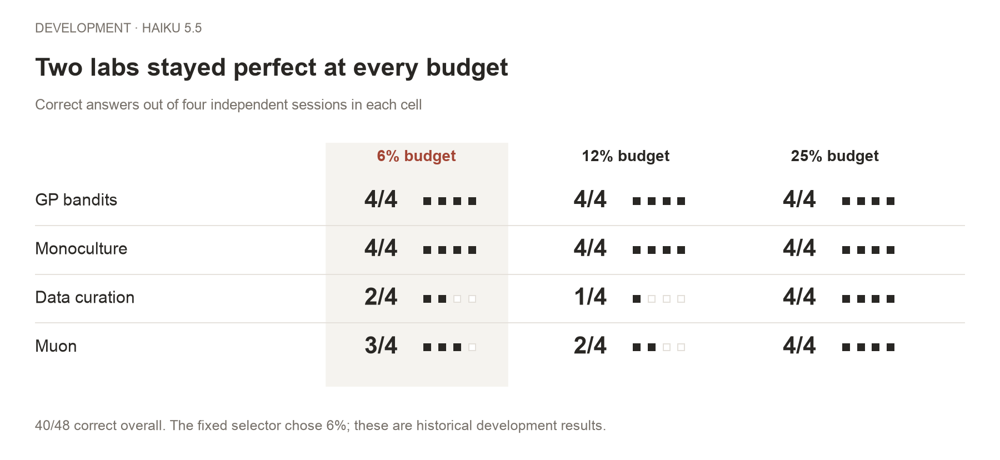
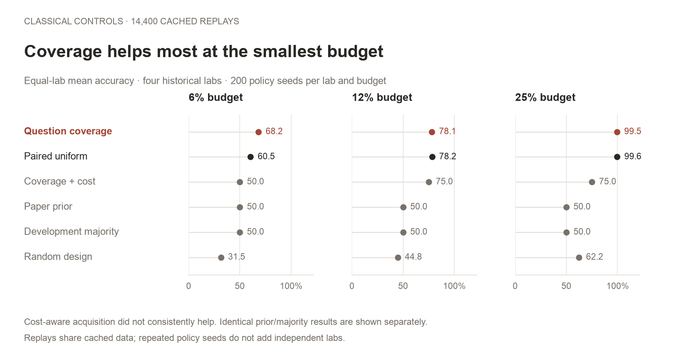

# Development evidence

## Model sessions

Four historical miniature labs, four real Haiku sessions per lab and budget, and a fixed selection rule. **40/48 correct.** The rule chose a 6% budget on these data. Its independent evaluation is in the [fresh confirmation report](../release-results/report.md).



## Classical controls

Four labs × six policies × three budgets × 200 policy seeds: **14,400 cached trials**. Cost-aware acquisition did not consistently improve over simpler policies. Repeated policy seeds reuse the same tables; they are not independent labs.



## Data and rendering

[summary.json](summary.json) contains the original cell counts and equal-lab policy means. Private snapshot hashes provide provenance. The main reproducer checks the development budget selection and fresh analysis; the historical policy aggregate is a separate descriptive supplement.

To regenerate the publication figures from packaged evidence:

```sh
uv run python -m publication.figures --output-dir /tmp/benchtop-figures
```

This starts no model or lab worker. The rendering command writes to the supplied directory; it does not reseal a modified publication package.
